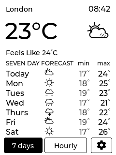
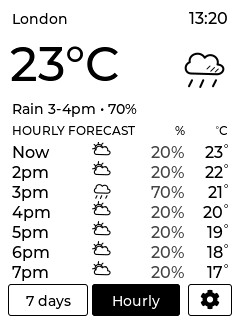
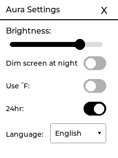
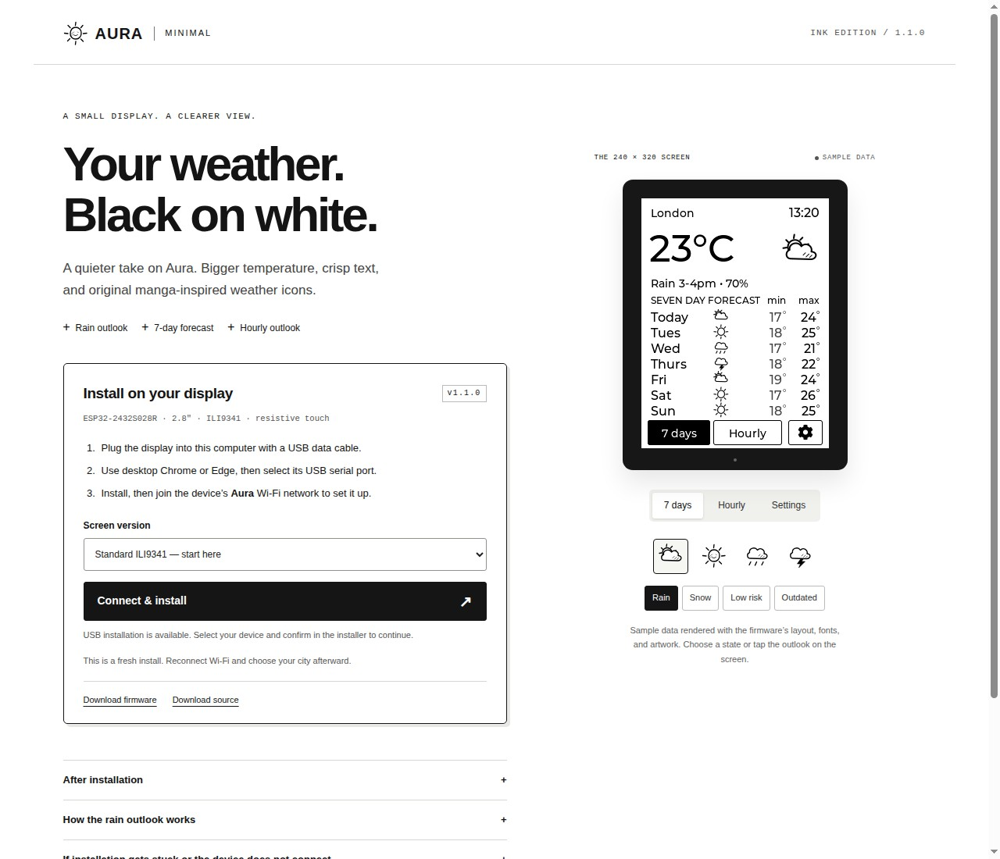

# Aura Minimal — Ink Edition 1.0.0

A modification of [Aura by Surrey Homeware](https://github.com/Surrey-Homeware/Aura) for the **ESP32-2432S028R with an ILI9341 display and XPT2046 resistive touch**. Based on upstream commit `ded60e3cd5c9fc41e2f049ff1da70c26820ee9e9`.

Aura Minimal turns the board's 240 × 320 display into a touch-controlled weather station with current conditions, a seven-day forecast, and an hourly outlook. The Ink Edition uses a white background, larger temperature text, and original manga-inspired weather icons. This repository includes the firmware source, precompiled firmware, and a local browser installer.

## Screenshots and previews

### Weather display

The images below are layout previews made with the firmware's fonts and artwork using sample weather data. They are not photographs or screenshots captured from physical hardware.

| Seven-day forecast | Hourly forecast | Settings |
| :---: | :---: | :---: |
|  |  |  |
| Current conditions above seven days of minimum and maximum temperatures. | Seven hourly entries with precipitation probability and temperature. | Brightness, night dimming, temperature units, clock format, and language. |

Tap **7 days** or **Hourly** at the bottom of the display to switch forecasts; tapping the forecast list also switches views. Tap the **gear** to open settings, then swipe upward for language, location, and Wi-Fi reset.

### Local USB installer



The installer lets you choose the standard or inverted firmware and flash it through USB. Its preview buttons switch between daily, hourly, and settings layouts; the weather icons change the sample conditions. These previews work without connecting a board. Select **Standard ILI9341** first; use the inverted version only if the display's black and white are reversed.

## Install locally

You need the supported board, a USB data cable, Node.js installed on your computer, and desktop Chrome or Edge for USB installation. No npm dependencies are needed to run the installer.

1. Clone this repository or extract the complete package into a folder on your computer.
2. On Windows, double-click **start-installer.cmd**. On other systems, open a terminal in this folder and run:

   ```sh
   node server.cjs
   ```

3. Open **http://localhost:8080** in desktop Chrome or Edge on the same computer.
4. Connect the board with a USB data cable. Keep **Standard ILI9341** selected first.
5. Choose **Connect & install**, select the board's USB serial port, and follow the installer.
6. After flashing, join the board's temporary **Aura** Wi-Fi network and enter your home Wi-Fi details. Choose your city using the display's settings.

The included firmware images are factory images: installing them resets the board's existing Wi-Fi and saved preferences. The inverted variant is for a board whose black and white are reversed; it is not firmware for ST7789 or another controller. The server only listens on this computer's loopback address. Stop it with Ctrl+C or close its window.

The website, installer scripts, firmware, icons and sample previews are all included locally. A public website, domain and internet connection are not required to flash. Weather fetching and initial clock synchronization need internet afterward. The original Aura installer is linked at the bottom of the local page if you want to restore the original firmware.

If installation stalls while connecting, hold **BOOT**, press and release **RESET/EN**, then release **BOOT** and retry. Close other installer tabs and serial monitors using the board's port. If necessary, reconnect the board with another USB data cable. After updating this repository, reload the installer page to load the fixed installer scripts. Connection attempts stop after seven tries and show an error if the board does not respond.

The installation dialog shows a live, timestamped log of connection attempts, chip detection, erasing, writing, and errors. Scroll up to inspect earlier messages; the log follows new messages again when you scroll to the bottom.

## Repository guide

| Path | Purpose |
| --- | --- |
| [`firmware/aura_minimal/`](firmware/aura_minimal/) | Arduino sketch, display layout, translations, fonts, and weather artwork. |
| [`website/`](website/) | Local installer page and interactive sample previews. |
| [`website/bin/`](website/bin/) | Precompiled firmware, installation manifests, and source archive. |
| [`website/assets/previews/`](website/assets/previews/) | Daily, hourly, and settings images shown above and in the installer. |
| [`config/`](config/) | Display and LVGL configuration used to build the firmware. |
| [`tools/`](tools/) | Firmware build script and icon generation tool. |
| [`server.cjs`](server.cjs) | Dependency-free local HTTP server for the installer. |

## Design and use

- Pure white background, black primary text, and dark gray secondary values.
- Main temperature increased from 42px to 48px.
- Nine original ink weather drawings, rendered separately at 20px and 48px. Small icons omit fine hatching to stay legible.
- All seven daily rows and seven hourly entries remain available.
- Dedicated daily, hourly and settings buttons; the forecast list also switches views when tapped.
- Units appear in the large reading and hourly heading rather than being repeated in every row.
- Location and time now have their own header. Long location names truncate instead of overlapping the clock.
- Settings use the same light palette and larger controls. Swipe upward in settings for language, location and Wi-Fi reset.
- Existing weather provider, city search, seven languages, brightness and night mode remain.

Primary text is black on white (21:1 calculated contrast). Secondary text `#454545` on white is about 9.6:1. Actual readability also depends on panel brightness and viewing angle. Preview images use the firmware's glyph data and artwork with sample readings; they are layout previews, not photographs or a full LVGL emulator.

## Included reliability changes

- The keyboard is attached to LVGL's top layer so a language change does not leave a deleted keyboard pointer.
- Location search results are bounded to the dropdown buffer.
- Weather responses are checked for the expected entries before their dates are read.
- Network connection/read waits are bounded. Network requests still run synchronously; this release does not claim fully asynchronous networking.
- LVGL timing reads the real millisecond clock rather than counting fixed loop delays.

## Build the firmware again

The precompiled binaries are in `website/bin/`. You do not need a compiler to install them.

For rebuilding, install Arduino CLI from Arduino's official distribution, then run:

```powershell
powershell -ExecutionPolicy Bypass -File tools/build.ps1 -InstallDependencies
```

The script keeps its compiler packages and libraries inside this project's `.build/` directory. It uses ESP32 Arduino core **3.2.0**, **ESP32 Dev Module**, **Huge App (3 MB)**, and the versions listed in `UPSTREAM-README.md`. The included `config/User_Setup.h` goes into the TFT_eSPI library root; `config/lv_conf.h` goes into `lvgl/src/`.

The sketch is `firmware/aura_minimal/aura_minimal.ino`; its display layout is in `minimal_ui.h`. `AURA_INVERT_COLORS=1` builds the alternate display inversion version. The application uses Aura's original saved preference keys, though installing a merged factory image resets them.

Run `npm test` to check installer connection retries and serial port cleanup with simulated devices; these checks do not flash hardware.

Original icon vector sources are in `website/assets/icons/`; their LVGL image data is in `manga_icons.c`. To regenerate icon pixels, install Sharp with `npm install --ignore-scripts --no-audit --no-fund`, then run `npm run icons`. The browser installer is ESP Web Tools 10.1.1, vendored under `website/vendor/`.

## Verification and limitations

Both firmware variants must pass compilation before release. See `release.json` for the exact source and binary hashes, build sizes, and verification status. The website's manifests point to the corresponding merged factory images at address zero. Physical color order, display output, touch calibration, Wi-Fi onboarding, and live weather still require a test on the actual board. No device has been flashed as part of creating this package.

## Credits and licenses

Aura's application source is offered by its author under GPLv3. This modification and the new ink drawings are provided under GPL-3.0-only; see `LICENSE`. Attribution and upstream instructions are retained in `UPSTREAM-README.md`. The original Google weather artwork has been replaced with original drawings and is not included in this package. The retained Latin font additions and LVGL Montserrat fallback fonts retain their upstream licensing. ESP Web Tools and bundled dependencies retain their own licenses; see `THIRD-PARTY-NOTICES.md` and `website/vendor/`.
